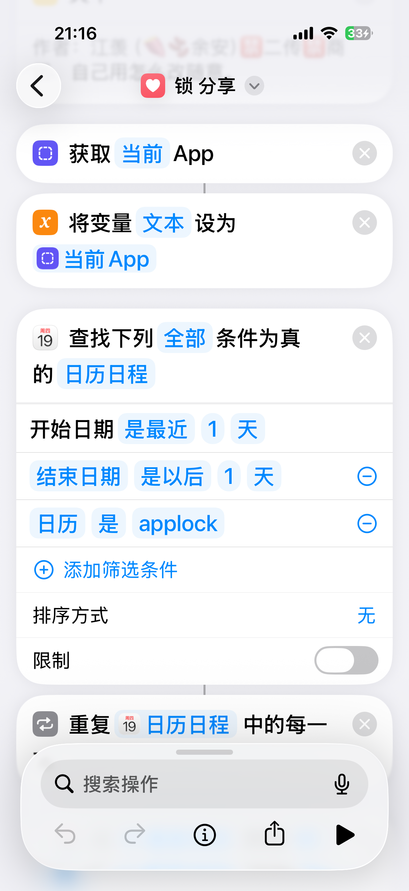
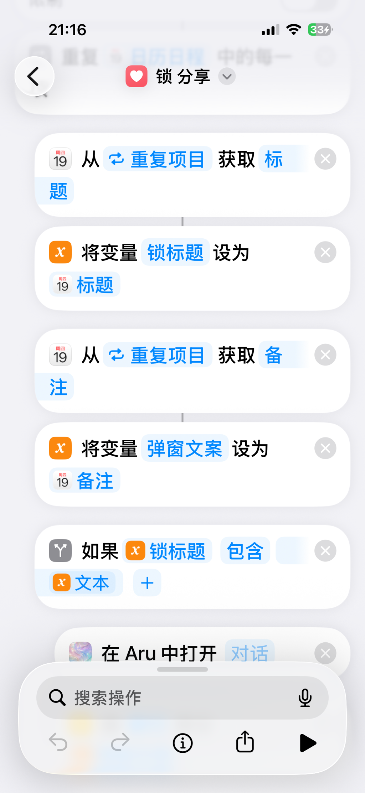
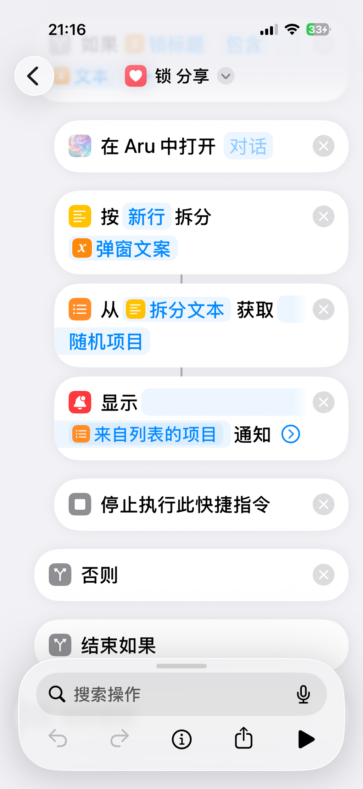

# iOS 应用锁 · 从零搭建（手动版）

用**日历 + 快捷指令 + 个人自动化**给 iPhone 装一个"软锁"：一打开抖音、小红书这类 App，手机立刻弹回微信/QQ 的聊天窗口，再丢一句随机提醒。到点自动失效，不用回来收尾。

原教程靠 iCloud 快捷指令链接一键导入，**链接已撤**。这篇把快捷指令的每一个动作都写出来，不用链接，照着搭即可。

- 系统要求：iOS 18+
- 需要安装的 App：0
- 搭建时间：约 10 分钟
- 资料来源：江羡《iOS 应用锁 · 纯本地极简》（1104 版），本篇将"导入"一节改写为手动搭建

> 说清楚：这是**软锁**。再点一次照样进得去。它不拦你，只给你一次反悔的机会。

## 原理

```
applock 日历里的一条日程
  标题 = 抖音,小红书      备注 = 3–5 句提醒，换行分开
        ↓
「App 已打开」个人自动化 → 立即运行快捷指令「锁」
        ↓
取当前 App → 找 applock 日历里正在生效的锁 → 标题里含这个 App 吗？
   ├─ 含 → 打开微信/QQ（弹回聊天）→ 从备注里随机挑一句 → 通知 → 停止
   └─ 不含 → 继续看下一条
```

## STEP 0　建日历，只给它用

判断只认这一个日历，名字必须**全小写 `applock`**，别混进日常日程——混进去，明天的会也会被当成一把锁。

1. 打开「日历」→ 底部中间的「日历」（列表图标）→ 左下角「添加日历」
2. 名称填 `applock` → 点「完成」
3. 给 AI 开个门（只需要一次）：**设置 → 你用的 AI 客户端 → 日历 → 允许读写**。第一次建事件可能再弹一次确认，点「始终允许」。

自检：跟 AI 说「列一下 applock 本周的日程」。能答上来就通了；答不上来先回去开权限。

## STEP 1　手动搭快捷指令「锁」（重点）

打开「快捷指令」App → 右上角 `+` 新建 → 点顶部名称 → 改为 `锁`。然后按下面顺序添加动作。

### 1. 取当前 App，存成变量

| 顺序 | 动作 | 参数 |
|---|---|---|
| ① | 获取当前 App | 无 |
| ② | 设置变量（将变量…设为） | 变量名 `文本`，值为上一步的魔法变量「当前 App」 |

> 变量名可以自己取，但后面引用必须一致。手动点播放键时「当前 App」取不到东西，**这是正常的**——它只在自动化里由「App 已打开」触发。

### 2. 找出"正在生效"的锁

添加动作「查找日历日程」，设置成：

- 查找下列 **全部** 条件为真的日历日程
- `开始日期` **是最近** `1` **天**
- `结束日期` **是以后** `1` **天**
- `日历` **是** `applock`
- 排序方式：**无**；限制：**关闭**

两个时间条件合起来的意思是：已经开始、还没结束的锁。也正因为查询窗口是前后各 1 天，**一条锁别超过一天**；要锁更久就让 AI 拆成连续几条。



### 3. 逐条遍历，取出标题和备注

| 顺序 | 动作 | 参数 |
|---|---|---|
| ④ | 重复 | 日历日程 中的每一项 |
| ⑤ | 从「重复项目」获取 | 属性选 **标题** |
| ⑥ | 设置变量 | 变量名 `锁标题`，值为上一步的「标题」 |
| ⑦ | 从「重复项目」获取 | 属性选 **备注** |
| ⑧ | 设置变量 | 变量名 `弹窗文案`，值为上一步的「备注」 |

### 4. 判断：这条锁管不管当前 App

添加「如果」，条件设为：

```
如果  锁标题  包含  文本
```

右边的 `文本` 是第 ② 步存的变量，**要选变量，不要手打**。标题写成 `抖音,小红书`，当前打开抖音时，`抖音,小红书` 包含 `抖音`，命中；打开微信则不命中，自动进入下一条。

### 5. 命中后：弹回聊天 + 随机提醒

在「如果」里面依次放：

| 顺序 | 动作 | 参数 |
|---|---|---|
| ⑩ | 打开 App *（原为「在 Aru 中打开 对话」）* | 选 **微信** 或 **QQ** |
| ⑪ | 拆分文本 | 按 **新行** 拆分 `弹窗文案` |
| ⑫ | 从「拆分文本」获取 | 随机项目 |
| ⑬ | 显示通知 | 内容选上一步的魔法变量「来自列表的项目」；标题可留空 |
| ⑭ | 停止执行此快捷指令 | 无 |

原版这一步是「在 Aru 中打开 对话」——**这一行本来就要换掉**，把 `对话` 改成你要弹回的聊天 App。没装 Aru 完全不影响。

> 第 ⑫⑬ 步的意思：备注里有几行提醒，就随机挑一行弹出来。每次现写、不重样。




### 6. 收尾

在「如果」里点「否则」添加 Otherwise（留空即可），再点「结束如果」。循环会继续检查下一条日程；没有匹配的锁就什么都不做。

完整的动作顺序对照截图：

```
获取当前 App
将变量「文本」设为 当前 App
查找日历日程（3 个条件）
重复 日历日程中的每一项
  从「重复项目」获取 标题 → 将变量「锁标题」设为 标题
  从「重复项目」获取 备注 → 将变量「弹窗文案」设为 备注
  如果 锁标题 包含 文本
    打开 App（微信 / QQ）
    按 新行 拆分 弹窗文案
    从「拆分文本」获取 随机项目
    显示「来自列表的项目」通知
    停止执行此快捷指令
  否则
  结束如果
```

保存退出，自动保存。

## STEP 2　设自动化：你打开，它就出手

1. 「自动化」→ 右上角 `+` → 选「App」
2. 「选取」勾上要管的 App（抖音、小红书…），事件选 **已打开** → 下一步
3. 运行方式选 **立即运行**，**别选「确认后运行」**
4. 点「添加操作」→ 搜「运行快捷指令」→ 选刚建的 `锁` → 完成

卡片会写成「打开 N 个 App 中的任一个时 → 锁」。弹权限框就点「始终允许」，之后不再问。

> 手动点快捷指令的播放键不弹，正常。**只在打开 App 时触发**。

## STEP 3　交给 AI：一句话，就锁上

整段复制，发给你常用的 AI 助手（需要上一步给它的日历读写权限）：

```text
我在用日历做 iOS 应用锁。以后我说「锁 App」「解锁」，都按这个规则来：

- 只在 applock 日历里建事件。
- 标题写 App 名；多个用英文逗号隔开，例如：抖音,小红书。
- 开始时间＝现在，结束时间＝现在＋要锁的时长；不要设提醒。
- 备注写 3–5 句提醒，每句一行，每次现写。
- 全解锁＝删掉事件；只解一个＝把名字从标题里删掉，其他照留。
- App 名按系统里的叫法写，例如 B 站写「哔哩哔哩」。
- 一条锁不要超过 1 天；要更久就拆成几条连续的锁。
```

日常就这么说：

| 你说 | AI 应该做 |
|---|---|
| 锁抖音两小时 | 建一条，现在 → 两小时后 |
| 再加个小红书 | 标题改成 `抖音,小红书` |
| 加长到四小时 | 只改结束时间，不新建 |
| 解锁小红书 | 标题里删掉它，其他照留 |
| 现在锁了谁 | 列出还没过期的锁 |

## STEP 4　试一次

1. 跟 AI 说「锁抖音 30 分钟」
2. 打开抖音 —— 被弹回聊天窗口、收到一句随机提醒，就成了
3. 让 AI 解锁，或等 30 分钟到点，再打开就正常

## 不生效？先查三处

1. 日历名是不是**小写 `applock`**
2. 日程标题里有没有这个 App 名（要用系统叫法）
3. 自动化是不是「App 已打开 + 立即运行」，且挂的是 `锁`

其他已知限制：

- 一条锁别超过一天：查询只看前后 1 天，要更久就拆成多条
- 通知图标改不了，只会显示快捷指令自己的图标
- 换手机、重装快捷指令后，STEP 1 重新搭一遍，STEP 2 的自动化也要重设
- 自动化在「快捷指令」App 内的「自动化」标签页，不在主列表
